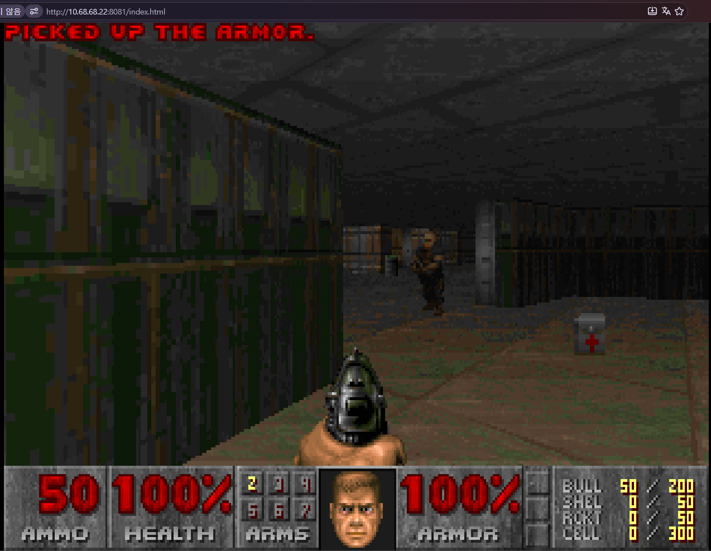
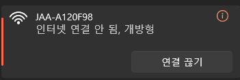
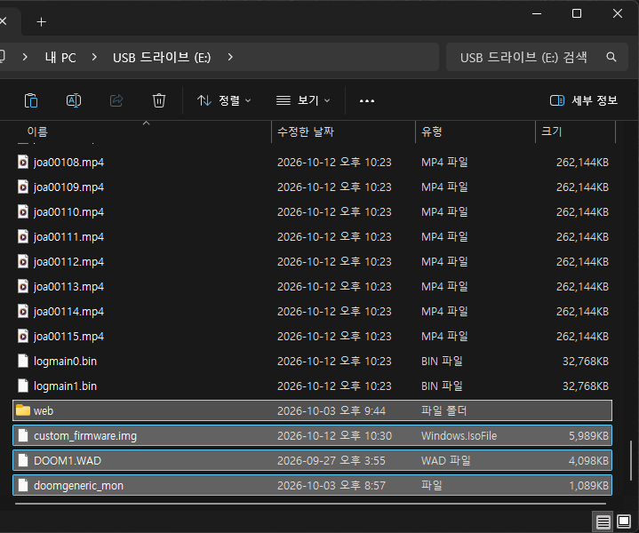
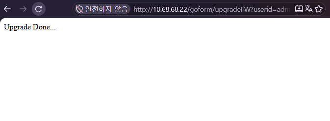
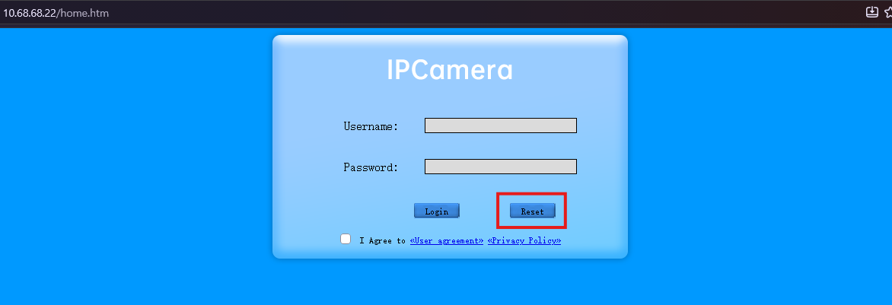

# 임베디드 기기 대상 DOOM 포팅하기
> 연구 기간: 2026년 8월 ~ 2026년 10월 (약 3개월)

본 저장소는 WhiteHat School 4기에서 진행한 프로젝트로, **임베디드 기기의 하드웨어 및 펌웨어를 분석하고, 분석한 실행 환경에 맞게 DOOM을 포팅하는 연구 프로젝트**의 수행 과정과 결과를 기록하고 공유함으로써, 차후 진행될 임베디드 기기 관련 보안에 기여하고자 합니다.

---
```
Repository Notice

본 저장소의 모든 자료는 프로젝트 수행, 연구 및 학습 목적으로만 사용됩니다.

프로젝트 과정에서 다루는 펌웨어 분석, Firmware Modification, 디버깅 및 기타 보안 관련 기술은 허가된 실습 장비와 연구 환경에서만 수행하며, 타인의 시스템이나 기기에 대한 비인가 접근, 공격 또는 기타 악의적인 목적으로 사용하지 않습니다.

본 저장소의 내용은 실제 공격이나 불법 행위를 유도하는 목적으로 하지 않으며, 임베디드 시스템의 구조와 동작 방식을 이해하고 분석한 내용을 공유하는 것을 목적으로 합니다.
```

## 저자
> WhiteHat School 4기 Embediz 팀
- Mentor: 문석주
- PL: 장형범
- PM: 유수민
- Mentee: 김가온, 김규민, 김민서, 민준기, 손민우, 최수연, 황원민
  
---
## 초록 (Abstract)
### 연구의 필요성

임베디드 시스템의 구조와 동작 방식을 이해하기 위해서는 실제 기기를 직접 분석하는 과정이 필요합니다.

임베디드 기기는 기기마다 하드웨어 구성과 펌웨어 환경이 달라, 이론만으로는 내부 구조와 프로그램 실행 과정을 정확하게 파악하기 어렵습니다.

이에 홈캠의 주요 부품과 펌웨어를 분석하고, 분석한 실행 환경에 맞게 DOOM을 포팅하여 외부 프로그램이 실제 장비에서 실행되는지 확인합니다.

이를 통해 임베디드 기기의 **하드웨어 분석부터 펌웨어 분석과 실행 환경 검증까지의 전 과정**을 익히는 것을 목적으로 합니다.

---

### 연구의 목표

> **홈캠의 하드웨어와 펌웨어를 단계적으로 분석하고, 분석한 실행 환경에 맞게 DOOM을 포팅하여 실제 장비에서 구동하는 것을 목표로 합니다.**
- 관련 연구
  - 선행 연구를 통해 임베디드 기기의 분석 및 수정 방법 익히기
    
- 펌웨어 분석
  - 홈캠에서 펌웨어를 확보하여 분석 환경 구축하기
  - 펌웨어의 내부 구조와 주요 파일 및 실행 흐름 파악하기
  - 동적 분석을 통해 주요 프로그램의 동작 확인하기
    
- 파일 변조 및 리패키징 사전 실습
  - 펌웨어 내부 파일의 수정 가능 여부 확인하기
  - 수정한 파일을 펌웨어에 반영하는 방법 익히기
  - DOOM 포팅에 필요한 파일과 수정 지점 파악하기
    
- DOOM 포팅 구현
  - 홈캠의 실행 환경에 맞는 DOOM 바이너리 생성하기
  - 웹서버를 활용하여 DOOM 실행 기능 구현하기
  - 브라우저를 통한 화면 출력 및 키 입력 구현하기
    
- 실험 및 결과
  - 수정한 펌웨어를 실제 홈캠에 적용하기
  - DOOM의 실행 및 화면 출력, 키 입력 동작 검증하기
  - 구현 결과와 기술적 한계 확인하기
    
- 결론 및 향후 연구
  - 프로젝트 목표 달성 여부와 주요 성과 정리하기
  - 구현 과정에서 발생한 문제와 해결 방법 정리하기
  - 기존 홈캠 앱을 통한 화면 출력 및 결함 주입 연구 방향 제시하기


---

### 대상
> 연구에 사용되는 임베디드 기기의 하드웨어 구성, 펌웨어 및 실행 환경을 분석 대상으로 합니다.

본 연구의 대상 기기는 중국 JOOAN사의 홈캠(jooan-c9ts)입니다.

<p align="center">
  
</p>

### 결과
장치의 핫스팟에 연결한 후 아래의 엔드포인트에 접속해 둠을 플레이할 수 있습니다.
```
http://10.68.68.22:8081/index.html
```


#### 설치
둠을 설치하기 위한 과정은 다음과 같습니다.

[커스텀 펌웨어 및 둠 바이너리, 쉐어웨어 WAD파일](./DOOM_C9TS_포팅_버전_및_펌웨어/)

1. 장치의 전원을 켜고 장치의 핫스팟에 연결합니다



2. 커스텀 펌웨어, 포팅된 doom 바이너리, wad 파일을 전부 다운받은 후, sd카드에 배치 후, 웹캠의 다음 엔드포인트로 접속합니다.



```
http://10.68.68.22/goform/upgradeFW?userid=admin&userkey=0192023a7bbd73250516f069df18b500&filename=/mnt/sd_card/custom_firmware.img
```

링크 접속시 잠시 기다리면 다음 화면과 함께 자동 재시작합니다.



3. 펌웨어 업데이트가 완료된 후, 브라우저에서 10.68.68.22에 접속해 reset 버튼을 누릅니다.



4. 둠이 작동하는 엔드포인트로 자동 이동해 doom을 플레이할 수 있습니다.


둠 조작법은 다음과 같습니다.

| 키              | 게임 동작       | 전송하는 DOOM 키 코드  |
| -------------- | ----------- | --------------- |
| W / S          | 전진 / 후진     | `0xad` / `0xaf` |
| A / D          | 왼쪽 / 오른쪽 이동 | `0xa0` / `0xa1` |
| Q / E          | 왼쪽 / 오른쪽 회전 | `0xac` / `0xae` |
| ↑ / ↓          | 전진 / 후진     | W / S와 같은 코드    |
| ← / →          | 왼쪽 / 오른쪽 회전 | Q / E와 같은 코드    |
| Enter          | 선택          | `13`            |
| Space          | 사격          | `0xa3`          |
| Ctrl           | 문 열기 및 사용   | `0xa2`          |
| Shift          | 달리기         | `0xb6`          |
| 키보드 상단의 숫자 1~7 | 무기 선택       | ASCII `49`~`55` |
| Tab            | 지도 표시       | `9`             |

#### 둠 포팅 실행 결과

https://github.com/user-attachments/assets/6dd5558f-63c3-40bf-b55a-29a4ddd6ddfc

## 프로젝트 목차
1. [관련 연구](./01%20관련%20연구/)
    - [선행 연구 분석](./01%20관련%20연구/01%20선행%20연구%20분석/README.md)
      
2. [대상 시스템 및 분석 환경](./02%20대상%20시스템%20및%20분석%20환경/)
    - [대상 시스템 및 분석 환경](./02%20대상%20시스템%20및%20분석%20환경/01%20대상%20시스템%20및%20분석%20환경/)
      
3. [펌웨어 분석](./03%20펌웨어%20분석/)
    - [펌웨어 추출](./03%20펌웨어%20분석/01%20펌웨어%20추출/README.md)
    - [binwalk를 통한 정적 구조 분석](./03%20펌웨어%20분석/02%20binwalk를%20통한%20정적%20구조%20분석/README.md)
    - [바이너리 정적 분석](./03%20펌웨어%20분석/03%20바이너리%20정적%20분석/README.md)
    - [동적 구조 분석](./03%20펌웨어%20분석/04%20동적%20구조%20분석/README.md)
    - [업데이트 로직 분석](./03%20펌웨어%20분석/05%20업데이트%20로직%20분석/README.md)
      
4. [파일 변조 및 리패키징 사전 실습](./04%20파일%20변조%20및%20리패키징%20사전%20실습/)
    - [rcS](./04%20파일%20변조%20및%20리패키징%20사전%20실습/01%20rcS/README.md)
    - [inittab](./04%20파일%20변조%20및%20리패키징%20사전%20실습/02%20inittab/README.md)
    - [goahead](./04%20파일%20변조%20및%20리패키징%20사전%20실습/03%20goahead/README.md)
    - [업데이트 적용](./04%20파일%20변조%20및%20리패키징%20사전%20실습/04%20업데이트%20적용/README.md)
      
5. [DOOM 포팅 구현](./05%20DOOM%20포팅%20구현/)
    - [크로스컴파일 환경 구성](./05%20DOOM%20포팅%20구현/01%20크로스컴파일%20환경%20구성/README.md)
    - [화면 출력 구현](./05%20DOOM%20포팅%20구현/02%20화면%20출력%20구현/README.md)
    - [조작 입력 구현](./05%20DOOM%20포팅%20구현/03%20조작%20입력%20구현/README.md)
    - [둠 트리거 구현](./05%20DOOM%20포팅%20구현/04%20둠%20트리거%20구현/README.md)
      
6. [실험 및 결과](./06%20실험%20및%20결과/)
    - [실기기 동작 확인](./06%20실험%20및%20결과/01%20실기기%20동작%20확인/README.md)
    - [결과 분석 및 한계](./06%20실험%20및%20결과/02%20결과%20분석%20및%20한계/README.md)
      
7. [결론 및 향후 연구](./07%20결론%20및%20향후%20연구/)
    - [결론 및 향후 연구](./07%20결론%20및%20향후%20연구/01%20결론%20및%20향후%20연구/README.md)